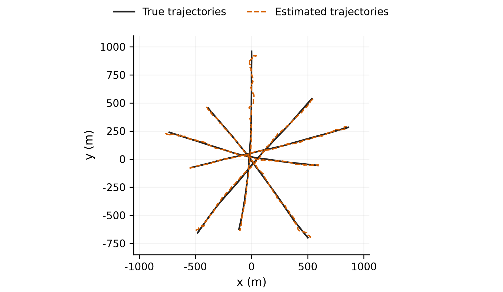
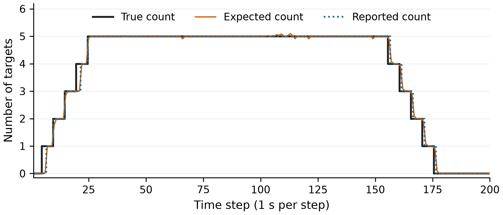
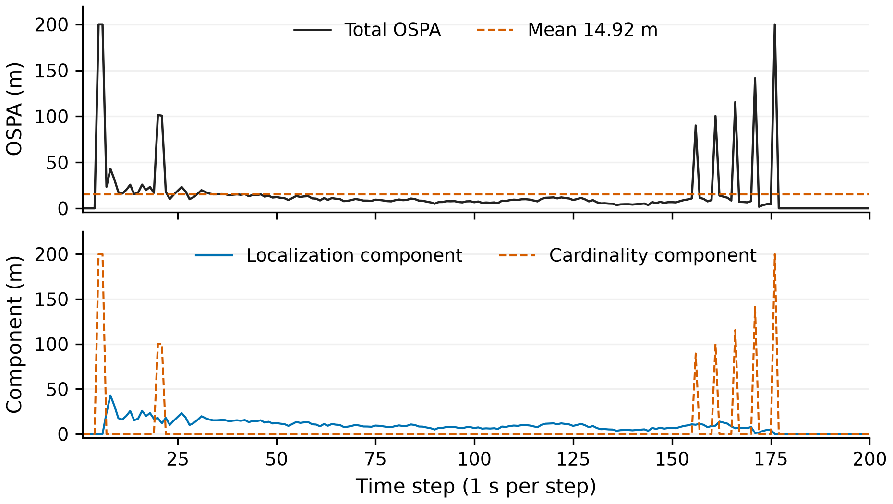
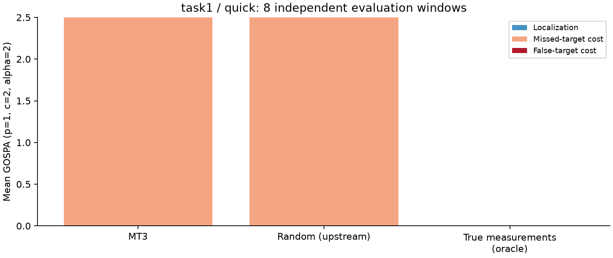
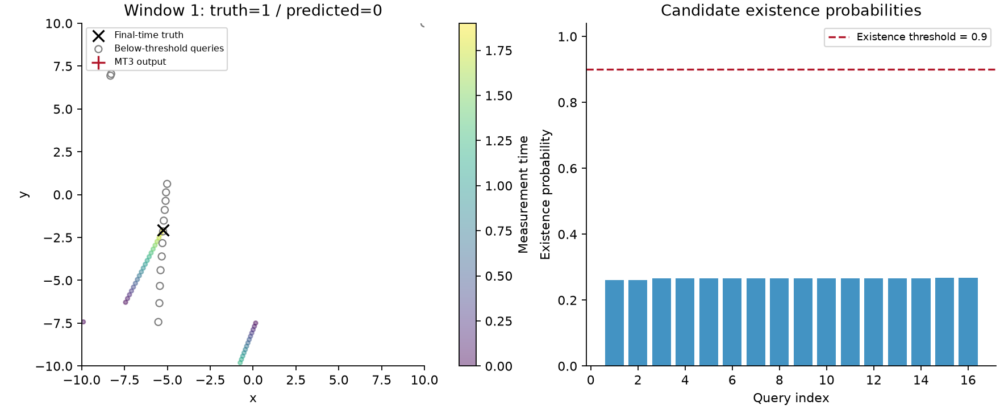

# Message Passing Algorithms for Scalable Multitarget Tracking test

<!-- MT3 experiment index -->
本仓库现在包含两项独立的多目标跟踪实验：原有BP实验，以及新增的 **MT3（Transformer）实验**。仓库名称沿用原BP项目名称。

| 实验 | Notebook | 方法与结果 | 主要来源 |
|---|---|---|---|
| BP：粒子置信传播跟踪 | [MTT_BP_Python.ipynb](MTT_BP_Python.ipynb) | [本页介绍](#bp实验)及[实现说明](docs/IMPLEMENTATION.md) | Meyer等，IEEE TSP 2017 |
| MT3：Transformer集合预测 | [MT3_Reproduction.ipynb](experiments/mt3/MT3_Reproduction.ipynb) | [本页介绍](#mt3实验)、[运行说明](experiments/mt3/README.md)、[方法机理](experiments/mt3/docs/METHOD.md)、[实验报告](experiments/mt3/docs/EXPERIMENT_REPORT.md) | Pinto等，2021，[arXiv:2104.00734](https://arxiv.org/abs/2104.00734) |

MT3已完成短程训练与流程验证，未完成论文精度复现。两项实验使用不同场景和指标（BP的OSPA、MT3的GOSPA），示例数值不能直接作为算法性能排名。MT3依赖与运行入口在`experiments/mt3/`中，根目录命令对应BP。

---

## BP实验

基于置信传播（Belief Propagation，BP）的多目标跟踪实验，提供可独立运行的 Python / Jupyter Notebook。

### 论文与代码来源

**BP实验参考以下论文的实验代码进行 Python / Jupyter 转换与整理：**

> Meyer F, Braca P, Willett P, Hlawatsch F. A Scalable Algorithm for Tracking an Unknown Number of Targets Using Multiple Sensors[J]. IEEE Transactions on Signal Processing, 2017, 65(13): 3478–3493. DOI: 10.1109/TSP.2017.2688966.

- 论文：[DOI: 10.1109/TSP.2017.2688966](https://doi.org/10.1109/TSP.2017.2688966)
- 原始 MATLAB 实现：[meyer-ucsd/MTT-PIEEE-18](https://github.com/meyer-ucsd/MTT-PIEEE-18)
- 原始代码作者：**Florian Meyer（2017、2020）**
- 转换所依据的提交：[`d2e02df90d85aca5ad1120d80f8ba66946e903ca`](https://github.com/meyer-ucsd/MTT-PIEEE-18/commit/d2e02df90d85aca5ad1120d80f8ba66946e903ca)

这是非官方的学习与实验移植。仓库名称采用2018年综述 *Message Passing Algorithms for Scalable Multitarget Tracking* 的标题；
主要实验参考文献为上述2017年论文。原始 `main.m` 同时引用这两篇文章，详见 [参考文献](REFERENCES.bib) 和 [来源说明](THIRD_PARTY_NOTICES.md)。

### 快速运行

1. 安装 Python，并在 VS Code 安装 **Python** 和 **Jupyter** 扩展。
2. 克隆仓库，在项目文件夹建立虚拟环境并安装依赖：

```bash
git clone https://github.com/15016623369a-spe/Message-Passing-Algorithms-for-Scalable-Multitarget-Tracking-test.git
cd Message-Passing-Algorithms-for-Scalable-Multitarget-Tracking-test
python -m venv .venv
# macOS / Linux
source .venv/bin/activate
# Windows PowerShell 使用：.venv\Scripts\Activate.ps1
python -m pip install -r requirements.txt
```

3. 打开 [MTT_BP_Python.ipynb](MTT_BP_Python.ipynb)，选择 `.venv` 对应的 Python 内核，点击 **全部运行**。

算法代码全部内嵌于 Notebook；不需要安装 MATLAB，也不需要加载 `bp_tracking.py`。
Notebook 在仓库中保留为空输出版本，结果运行后会显示，并写入当前工作目录的 `results/`。

也可以从终端完整执行并把带输出的 Notebook 保存到 `results/`：

```bash
python run_notebook.py
# 首次检查环境时可运行小实例（30帧、500粒子）：
python run_notebook.py --quick
```

快速实例不能代替默认规模实验。`results/` 已加入 `.gitignore`，避免每次运行都改动仓库中的 Notebook 或提交本机运行信息。

### 默认实验设置

| 参数 | 数值 |
|---|---:|
| 仿真帧数 / 帧间隔 | 200 / 1秒 |
| 真实目标总数 / 传感器数 | 5 / 2 |
| 每个潜在目标的粒子数 | 10000 |
| 随机种子 | 1 |
| 单传感器探测概率 | 0.9 |
| 每帧每传感器平均杂波数 | 5 |
| 距离 / 方位角噪声标准差 | 25米 / 0.5度 |
| 输出存在概率阈值 | 严格大于0.5 |
| 附加位置OSPA参数 | p=2，c=200米 |

`QUICK_CHECK=False` 为默认完整实验。可在参数单元格修改 `SEED`、粒子数等设置；修改后应从头运行。
状态为 `[x, y, vx, vy]`；方位角采用度数，从正y轴起算，使用 `atan2(dx, dy)`。

### 示例结果

以下来自一次固定种子1、200帧、10000粒子的运行，示例CSV和摘要位于 [examples/](examples/)。

| 指标 | 本次示例 |
|---|---:|
| 帧级数量完全正确 | 191/200（95.5%） |
| 输出数量MAE | 0.045 |
| 期望数量MAE | 0.05197 |
| 全程平均位置OSPA | 14.92米 |
| 所有BP更新满足数值停止条件 | 是 |
| 最大BP迭代次数 | 740 |

数量正确率按每帧输出目标数是否等于真实数量计算；它不是逐目标检测率或身份识别准确率。
OSPA综合匹配后的位置误差与数量差惩罚，本实现只评价二维位置，不衡量速度或ID切换。
示例核心实验时间约4.13秒，仅供记录；运行时间随硬件、依赖版本和系统负载变化。







### 文件说明

| 文件 | 用途 |
|---|---|
| `MTT_BP_Python.ipynb` | 中文分节说明、完整内嵌算法、运行、图表、OSPA与结果保存 |
| `bp_tracking.py` | 与Notebook算法对应的Python模块，便于阅读和导入 |
| `run_notebook.py` | 用当前解释器启动新内核并执行Notebook |
| `requirements.txt` | 运行和执行Notebook所需依赖 |
| `examples/` | 示例逐帧指标与摘要，不参与算法输入 |
| `docs/images/` | 示例数据的结果图 |
| `docs/IMPLEMENTATION.md` | 原MATLAB文件对应关系及实现边界 |
| `REFERENCES.bib` / `CITATION.cff` | 论文引用信息 |
| `THIRD_PARTY_NOTICES.md` | 原始作者、来源与许可说明 |

### 复现范围

保留原演示的运动和量测模型、默认参数、BP关联方程、顺序多传感器更新、系统重采样、出生及剪枝流程。
新增中文说明、收敛诊断、结果CSV和仅位置OSPA。
Python和MATLAB随机数生成器及抽样顺序不同，因此即使种子相同也不应逐点相等。
尚未通过MATLAB引擎对同一输入逐值比较，也未复现论文全部对比方法、多随机种子统计或大规模实验。
BP达到数值停止条件不等于证明其近似后验是精确的；单次示例也不足以说明方法优于其他算法。

已验证的运行环境为 Python 3.14.7、NumPy 2.5.2、SciPy 1.18.1、Matplotlib 3.11.2、pandas 3.0.6。
依赖文件给出最低版本约束；其他版本的运行与数值一致性需在对应环境检验。

### 引用与署名

使用BP实验时请引用上述2017年论文，并保留原始代码仓库与原作者署名。
另参阅 [REFERENCES.bib](REFERENCES.bib) 和 [BP引用信息](docs/BP_CITATION.cff)。BP移植部分未添加覆盖上游代码的MIT、Apache等再授权声明；
其上游来源和许可状态见 [THIRD_PARTY_NOTICES.md](THIRD_PARTY_NOTICES.md)。

---

## MT3实验

基于Transformer的多目标跟踪实验，使用作者的模型、损失和量测生成代码，整理为带中文讲解的 [MT3_Reproduction.ipynb](experiments/mt3/MT3_Reproduction.ipynb)。Notebook包含方法机理、在线生成训练数据、训练、检查点保存与重新加载、独立测试、GOSPA分解及结果可视化。

### 论文与代码来源

**MT3实验对应以下论文及其作者代码：**

> Pinto J, Hess G, Ljungbergh W, Xia Y, Svensson L, Wymeersch H. Next Generation Multitarget Trackers: Random Finite Set Methods vs Transformer-based Deep Learning. 2021. arXiv:2104.00734. DOI: 10.48550/arXiv.2104.00734.

- 论文：[arXiv:2104.00734](https://arxiv.org/abs/2104.00734)
- 作者代码：[JulianoLagana/MT3](https://github.com/JulianoLagana/MT3)
- 整理依据的提交：[`c1270e1de5b8d68eab50a797d16061310fa95d97`](https://github.com/JulianoLagana/MT3/commit/c1270e1de5b8d68eab50a797d16061310fa95d97)
- 上游43个源码、配置和许可文件保持原样，校验记录见 [SOURCE_MANIFEST.json](experiments/mt3/SOURCE_MANIFEST.json)。

这是一项基于作者代码的非官方Notebook适配。MT3对应Pinto等人的2021年论文；上方Meyer等人的2017年论文对应BP实验，两项实验分别标明来源。

### 方法机理

MT3学习把一个时间窗口内的量测集合映射为窗口末时刻的目标位置集合。每条输入量测为`[x, y, t]`，网络输出16个候选位置和各自的存在概率，再通过阈值确定输出目标数。

1. **量测编码与Encoder：** 位置映射为256维特征并加入时间编码；自注意力让不同位置、不同时间的量测结合上下文信息。
2. **Two-stage目标查询：** Encoder先产生位置proposal及目标分数，选取16项初始化Decoder查询。查询是候选槽位，不是固定的目标ID。
3. **Decoder与位置细化：** 候选之间进行自注意力，并对量测特征进行交叉注意力，逐层修正候选位置，同时预测目标存在概率。
4. **集合匹配与监督：** Hungarian算法为无序真目标和预测槽寻找一对一配对，再计算位置L1损失和存在性BCE，避免标签排列影响训练。
5. **对比学习：** 用仿真真实ID构造同源量测监督，使同一目标的量测表示更相近；真实ID不作为网络推理特征。

默认训练还包含中间Decoder层及Encoder输出的辅助损失，并加入4倍对比损失。完整公式与源码对应见 [方法机理](experiments/mt3/docs/METHOD.md)，同样写在Notebook中。

### 快速运行

在已克隆仓库的根目录终端执行，推荐使用Python 3.12，并为MT3建立独立环境：

```bash
cd experiments/mt3
python3 -m venv .venv
# macOS / Linux
source .venv/bin/activate
# Windows PowerShell: .venv\Scripts\Activate.ps1
python -m pip install -r requirements-notebook.txt
python -m ipykernel install --user --name mt3-experiment --display-name "Python (MT3)"
```

在VS Code打开 [MT3_Reproduction.ipynb](experiments/mt3/MT3_Reproduction.ipynb)，选择 **Python (MT3)** 内核并点击“全部运行”。需要保留同目录的`MT3/`源码文件夹。根目录的`requirements.txt`和`run_notebook.py`用于BP；MT3使用`experiments/mt3/`内的依赖与入口。

也可以在`experiments/mt3/`目录用当前解释器启动新内核执行：

```bash
python run_notebook.py
# Task 2额外流程检查
python run_notebook.py --task task2 --steps 2 --batch-size 1 --eval-windows 2 --output Task2_validation.executed.ipynb
```

### 默认设置与复现范围

| 设置 | 默认短程实验 |
|---|---|
| 模式 / 任务 | `PROFILE='quick'` / `TASK='task1'` |
| 模型参数数目 | 18118165，保留原模型规模 |
| Encoder / Decoder | 各6层，每层8头注意力 |
| 特征维度 / 查询数 | 256 / 16 |
| 每窗口时刻数 / 间隔 | 20 / 0.1 |
| 优化步数 / batch | 20 / 2 |
| 独立测试窗口数 | 8 |
| 初始权重 / 随机种子 | 随机初始化 / 训练0、评估1 |
| 评估GOSPA | p=1，c=2，alpha=2 |
| 存在概率阈值 | 严格大于0.9 |

20个输入时刻、20次优化和8个测试窗口是不同计数。标签为窗口末时刻二维位置；当前评估不计算跨窗口轨迹ID或速度误差。

`PROFILE='full'`加载原YAML的100万优化步、batch=32和1000个测试窗口。它表示作者仓库原配置，不能直接等同于论文设置：当前`task1.yaml`是无量测噪声、无杂波的简化场景，与论文Task 1不同；训练预算、出生分布和过程噪声参数实现也有差异。详细核对见 [实验报告](experiments/mt3/docs/EXPERIMENT_REPORT.md)。

每次运行会在`experiments/mt3/results_mt3/`的独立子目录保存配置、训练与评估CSV、指标摘要、图表及检查点。大型权重文件未提交，本仓库没有训练充分的MT3预训练权重。

### 实测结果与解读

以下是已保存的真实短程运行结果，数据与图片见 [MT3 examples](experiments/mt3/examples/)。

| 案例 | 优化步数 | batch | 测试窗口数 | MT3平均GOSPA | 超过0.9阈值的预测 |
|---|---:|---:|---:|---:|---|
| 作者仓库Task 1 | 20 | 2 | 8 | 2.5000 | 所有窗口均为0 |
| 作者仓库Task 2额外流程检查 | 2 | 1 | 2 | 9.0000 | 所有窗口均为0 |

两组GOSPA全部由漏检构成。当前每漏检一个目标罚1；Task 1测试窗口的平均真目标数为2.5，因此空预测集合的平均GOSPA为2.5。定位项为0意味着没有匹配，不表示已经准确定位。

短程训练验证了前向、梯度更新、权重保存/重载及独立评估链路，尚不能证明达到论文精度。两组训练预算与样本量不同，不能用2.5和9直接评价任务间的性能差异；没有运行PMBM、δ-GLMB或多种训练种子的正式比较。



原Random参考的存在概率为0.5，经0.9阈值筛选后也输出空集合；oracle通过真实ID提取末时刻真实量测，拥有实际部署不可获取的关联信息。图中的参考项应按这些条件解读。



灰色空心点是未通过阈值的候选，黑叉是真实末时刻位置；候选存在概率均未超过0.9，因此不计入输出集合。

完整的训练曲线、逐窗口指标、GOSPA分解、配置差异及局限见 [MT3实验结果报告](experiments/mt3/docs/EXPERIMENT_REPORT.md)。BP的OSPA与这里的GOSPA定义、参数和场景不同，不直接比较原始数值。

### 文件说明

| 路径（相对于仓库根目录） | 用途 |
|---|---|
| [experiments/mt3/MT3_Reproduction.ipynb](experiments/mt3/MT3_Reproduction.ipynb) | 中文方法讲解与完整训练、评估流程 |
| [experiments/mt3/README.md](experiments/mt3/README.md) | 环境、运行与检查点使用说明 |
| [experiments/mt3/MT3/](experiments/mt3/MT3/) | 保持原样的作者源码、配置和MIT许可 |
| [experiments/mt3/docs/METHOD.md](experiments/mt3/docs/METHOD.md) | 机制公式与源码对应 |
| [experiments/mt3/docs/EXPERIMENT_REPORT.md](experiments/mt3/docs/EXPERIMENT_REPORT.md) | 实测结果与复现范围 |
| [experiments/mt3/examples/](experiments/mt3/examples/) | Task 1/2配置、CSV、摘要和图表 |
| [experiments/mt3/VALIDATION.json](experiments/mt3/VALIDATION.json) | 执行验证与源码校验记录 |

### 引用与署名

使用MT3实验时请引用上述Pinto等人的2021年论文，注明 [JulianoLagana/MT3](https://github.com/JulianoLagana/MT3)，并保留原作者署名和 [MT3/LICENSE](experiments/mt3/MT3/LICENSE)。引用信息见 [MT3 CITATION.cff](experiments/mt3/CITATION.cff) 与 [REFERENCES.bib](REFERENCES.bib)；许可范围及Notebook适配说明见 [MT3来源说明](experiments/mt3/THIRD_PARTY_NOTICES.md)。
