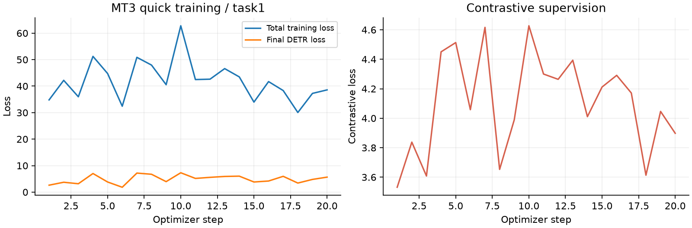
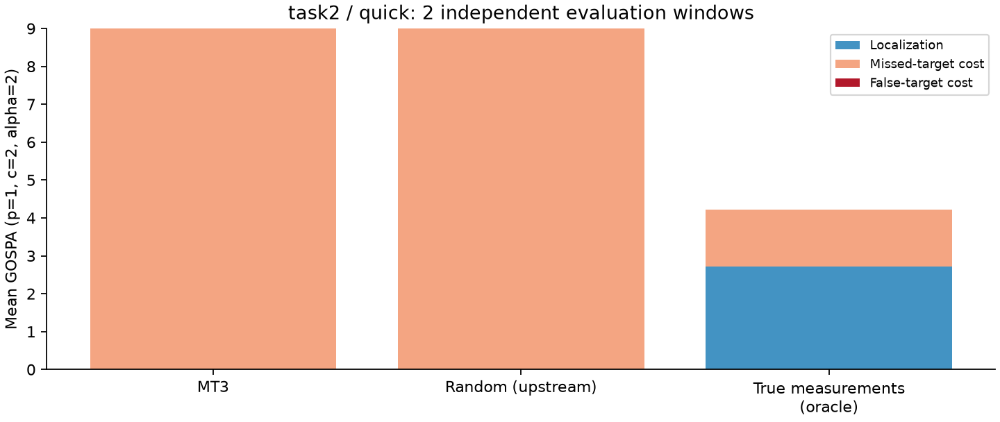

# MT3 多目标跟踪实验报告

日期：2026-10-19。实验性质：**作者代码的Notebook适配与短程训练验证**。本报告的MT3数据来自本目录保存的真实运行文件；根目录BP实验属于另一方法，不纳入本报告数值比较。

## 1. 实验目的与主要结论

目标是把作者的Transformer多目标跟踪代码整理为可逐格学习、可训练、可保存权重并独立评估的实验，同时解释集合预测机理和结果含义。

已通过Task 1与Task 2的训练、检查点重载及评估流程。原模型结构和43个上游文件保持不变。**当前训练远未充分：两组MT3预测均未通过0.9存在阈值，GOSPA全部来自漏检。** 结果不能用来声称达到论文精度、MT3优于BP/PMBM/δ-GLMB，或方法已经收敛。

## 2. 论文、代码与适配范围

论文：Pinto J, Hess G, Ljungbergh W, Xia Y, Svensson L, Wymeersch H. *Next Generation Multitarget Trackers: Random Finite Set Methods vs Transformer-based Deep Learning*. 2021. [arXiv](https://arxiv.org/abs/2104.00734)。方法、实现和实验设置分别见[原文第IV节与第V节](https://arxiv.org/html/2104.00734v3)。

代码：[JulianoLagana/MT3](https://github.com/JulianoLagana/MT3)，固定提交`c1270e1de5b8d68eab50a797d16061310fa95d97`。原作者MIT许可见[LICENSE](../MT3/LICENSE)。本次没有改动原模型、损失、仿真和YAML；新增Notebook入口、顺序生成适配、当前PyTorch调度器调用、结果保存和检查。

Notebook继承原`DataGenerator.get_batch()`；仅用顺序`starmap`替换进程池，并保留每个样本的SeedSequence分流。已核对两个任务连续批次的量测张量、mask、ID、标签和轨迹与原初始化方式一致。新环境去除旧调度器`verbose`参数，保留Adam及ReduceLROnPlateau逻辑。新建相同模型重载保存权重后，同一输入的state与logits在`rtol=atol=1e-6`内一致。

## 3. 方法概述

模型把窗口内所有`[x,y,t]`量测编码为特征，通过Encoder自注意力汇聚跨时刻证据；two-stage分支从Encoder proposal选择16个初始化查询。Decoder的自注意力与交叉注意力更新候选，逐层细化位置，最后输出位置与存在概率。Hungarian匹配将无序真目标与预测槽一对一配对，再计算位置L1与带权存在性BCE；辅助层和Encoder输出也参与训练。对比损失利用训练真ID鼓励同源量测特征相近。

详细公式、逐步解释与源文件对应见[方法机理](METHOD.md)，同样写在[Notebook](../MT3_Reproduction.ipynb)中。真实ID不作为推理特征；oracle参考项使用了真实ID，必须与模型输出区分。

## 4. 本地配置与论文设置的差异

下面“Task 1/2”首先表示上游仓库文件名，不能仅凭同名就认为复现了论文场景。

| 设置 | 仓库task1.yaml | 仓库task2.yaml |
|---|---:|---:|
| 窗口时刻数 / dt | 20 / 0.1 | 20 / 0.1 |
| 视场 | [-10,10]² | [-10,10]² |
| 输出槽 / 最大目标数配置 | 16 / 16 | 16 / 16 |
| 初始目标数Poisson均值 | 4 | 6 |
| 每步出生数Poisson均值p_add | 0 | 0.4 |
| 随机移除概率p_remove | 0 | 0.05 |
| 探测概率p_meas | 1 | 0.8 |
| sigma_q / sigma_y | 0 / 0 | 0.9 / 0.3 |
| 每时刻平均杂波数 | 0 | 30 |
| 损失正类权重所用avg_gt_objects | 3.1 | 5.335 |

原文第V-A节的Task 1包含探测率0.9、杂波强度0.05、sigma_q=0.5、sigma_z=0.1，随机存活概率0.95；这与当前简化Task 1明显不同。原文Task 2的探测率0.8、杂波强度0.075、sigma_q=0.9、sigma_z=0.3。400面积视场下，杂波强度0.075对应平均30个杂波。参数名相似仍需核对实现。

其他关键差异：

- 本源码出生位置在视场中均匀抽样；原文使用高斯出生状态分布。源码中的`mu_x0/std_x0`配置没有用于出生位置抽样。
- `sigma_q`直接乘入过程噪声协方差；原文用sigma_q的平方参数化。不要为了对齐名称而静默改动代码或把两者当成相同分布。
- 即使Task 1随机移除为0，目标离开视场仍会被移除。数据生成器重采样非空末时刻标签，当前结果不覆盖无目标末时刻窗口。
- 原YAML设100万优化步、batch=32；原文第V-B节报告Task 1训练80万步、Task 2训练60万步。`PROFILE='full'`只恢复原YAML训练量，不自动对齐论文场景。

因此，本次应称为**基于作者代码的MT3实验**。严格复现原文需要另行明确定义并验证论文场景配置。

## 5. 运行条件与实验设计

| 项目 | 本次设置 |
|---|---|
| Python / 设备 | 3.12.14 / CPU |
| PyTorch / NumPy / SciPy | 2.14.1 / 2.5.4 / 1.18.1 |
| Matplotlib / pandas / PyYAML | 3.11.2 / 3.0.6 / 6.0.3 |
| 可训练模型参数 | 18118165 |
| Encoder / Decoder | 6层 / 6层，每层8头 |
| d_model / 前馈维度 / dropout | 256 / 2048 / 0.1 |
| 查询数 / two-stage / 逐层细化 | 16 / 开启 / 开启 |
| 辅助层 / 对比损失 / false_classifier | 开启 / 4倍 / 关闭 |
| 优化器 / 初始学习率 | Adam / 0.00005 |
| 调度器 | ReduceLROnPlateau，patience=50000，factor=0.25 |
| 随机种子 | 训练0，评估1 |
| GOSPA / 存在阈值 | p=1，c=2，alpha=2；严格大于0.9 |
| 模型初始状态 | 随机初始化，无预训练权重 |

**案例A（Task 1短程训练）：** 优化20步，batch=2，随后评估8个新生成的独立窗口。每个窗口含20个时刻，标签是窗口末时刻目标集合。训练步数、输入时刻数和测试窗口数是不同计数。

**案例B（Task 2额外流程检查）：** 优化2步，batch=1，评估2个独立窗口，用于确认漏检、杂波与出生/死亡场景能够跑通。A与B训练预算不同，样本均很少，不能据此做任务性能排名。

训练与评估采用不同种子。这里仅一个训练种子，没有跨训练种子的置信区间；表中GOSPA标准差是本次测试窗口的总体标准差`ddof=0`，不是训练稳定性的估计。

## 6. 指标与参考项

GOSPA越低越好，同时计入匹配位置误差、漏检和虚警。当前`p=1, alpha=2, c=2`时，每个未匹配真实目标或预测各罚1；不按目标数归一化。报告使用未归一化定位项，因此三项之和等于GOSPA。数量MAE按阈值化输出数与真值数之差的绝对值求均值。这里不评估速度、轨迹连续性或ID切换。

`Random (upstream)`沿用作者代码，其logits=0、概率=0.5；在0.9阈值下实际输出空集合。它是源码参考项，不是一个训练过或调整过阈值的强基线。`True measurements (oracle)`通过真实ID选取末时刻真实量测，仍可能有量测噪声和漏检；它拥有实际部署不可获取的关联真值，并非普遍可达的零误差下界。

Prob-GOSPA使用软存在概率；DETR对应最终输出的训练损失。这两项原始值保存在CSV中，其尺度和含义不同于GOSPA，本报告不混用它们判断优劣。

## 7. 实验结果

### 7.1 Task 1：20步训练、8个测试窗口

| 方法 | 窗口数 | 平均GOSPA | GOSPA标准差 | 定位项 | 漏检项 | 虚警项 | 数量MAE |
|---|---:|---:|---:|---:|---:|---:|---:|
| MT3 | 8 | 2.5000 | 1.1180 | 0.0000 | 2.5000 | 0.0000 | 2.5000 |
| Random (upstream) | 8 | 2.5000 | 1.1180 | 0.0000 | 2.5000 | 0.0000 | 2.5000 |
| True measurements (oracle) | 8 | 0.0000 | 0.0000 | 0.0000 | 0.0000 | 0.0000 | 0.0000 |

真值目标数依次为`[1,4,2,2,3,1,3,4]`；MT3每个窗口预测数均为0。目标数均值为2.5，每个漏检罚1，所以GOSPA均值恰好为2.5。定位项与虚警项为0，是因为没有任何通过阈值的输出，不是模型已经精确定位。

Random参考与MT3的阈值化集合均为空，因而GOSPA相同。Oracle在这个无噪声、无漏检场景中直接获得真实末时刻量测，所以误差为0；这同时验证了场景与指标的预期关系。

图1：总损失包含辅助层，不能与最终DETR项视为同一个量。20步曲线有波动，不据此判定收敛。

图2：MT3与Random的GOSPA全为漏检代价，oracle为0。

图3：黑叉是真实末时刻位置，灰色空心点是未过阈值的候选；右侧概率条形图解释了为什么MT3输出数为0。左图彩色点包含窗口内所有时刻，不能与末时刻预测直接一一配对。

数据：[逐窗口CSV](../examples/task1_short/evaluation_windows.csv)、[汇总CSV](../examples/task1_short/evaluation_summary.csv)、[JSON摘要](../examples/task1_short/summary.json)、[训练记录](../examples/task1_short/training_history.csv)。

### 7.2 Task 2：2步训练、2个测试窗口

| 方法 | 窗口数 | 平均GOSPA | GOSPA标准差 | 定位项 | 漏检项 | 虚警项 | 数量MAE |
|---|---:|---:|---:|---:|---:|---:|---:|
| MT3 | 2 | 9.0000 | 2.0000 | 0.0000 | 9.0000 | 0.0000 | 9.0000 |
| Random (upstream) | 2 | 9.0000 | 2.0000 | 0.0000 | 9.0000 | 0.0000 | 9.0000 |
| True measurements (oracle) | 2 | 4.2223 | 1.2878 | 2.7223 | 1.5000 | 0.0000 | 1.5000 |

真值目标数为`[7,11]`，MT3预测数均为0，平均漏检代价为9。Oracle只得到末时刻实际被探测的真实量测，预测数为`[6,9]`，平均漏检数为1.5；量测噪声还带来平均定位代价2.7223，合计GOSPA约4.2223。该结果符合当前仿真含漏检和噪声的机制，但不是充分训练后的MT3结果。

图4：Task 2的oracle具有定位与漏检代价。MT3仍为空预测集合。

数据：[逐窗口CSV](../examples/task2_short/evaluation_windows.csv)、[JSON摘要](../examples/task2_short/summary.json)、[训练曲线](../examples/task2_short/training_loss.png)、[首窗口场景](../examples/task2_short/example_window.png)。

### 7.3 运行时间

保存的Task 1核心训练约1.357秒、评估约0.086秒；Task 2约0.588秒与0.125秒。这些是本机单次记录，未包含内核启动、依赖导入、绘图与完整权重写盘，未测重复误差或统一硬件，不能作为实时性或算法速度对比的结论。

## 8. 可靠性与局限

已检查：损失有限、模型可更新、检查点可重载、逐窗口GOSPA分解可相加、CSV统计与JSON摘要一致、两个任务顺序生成与原批量接口一致，以及43个上游文件SHA256未变。发布前再用新内核完整执行整理后的默认Notebook，结果数值核对见[VALIDATION.json](../VALIDATION.json)。

尚未完成：充分训练、论文场景对齐、1000窗口正式测试、多训练种子、PMBM/δ-GLMB复现、消融试验，以及跨窗口轨迹身份评价。本机运行环境与作者2021年的环境不同，相同种子跨版本或设备不保证逐位一致。

当前结果支持“Notebook实验链路可执行，并忠实保留固定版本的原始算法模块”，不能支持精度优越性结论。后续应先对齐论文仿真参数，再进行有预算记录的长期训练，固定独立测试集并加入匹配条件的基线与多种子统计。不要单独降低阈值以掩盖短程训练的漏检；若研究阈值影响，应在独立验证集上选阈值并同时报告虚警与漏检。

## 9. 如何复跑并形成自己的报告

按[README](../README.md)安装依赖并运行Notebook。每次运行保留独立配置、CSV、摘要、检查点和图表；在报告中记录训练步数、批量、种子、测试窗口数、阈值、硬件和数据分布。正式结果应替换本报告的短程表格，并保留对应原始数据。

本次提交的examples是历史运行快照，不作为模型输入。大型`.pt`未提交，需要本地生成；本仓库没有可直接得到论文表格精度的已训练权重。使用本实验请保留MT3原作者署名并引用本目录[CITATION.cff](../CITATION.cff)，BP实验的引用见根目录说明。
