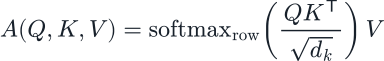
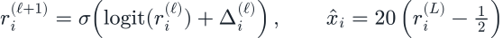
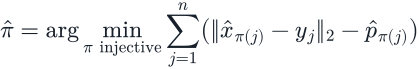
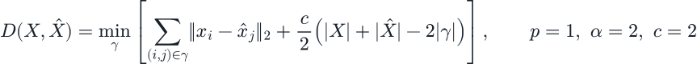

# MT3 方法机理与代码对应

本目录实现 **MT3（Transformer 多目标跟踪）实验**。论文是 Pinto 等人的 *Next Generation Multitarget Trackers: Random Finite Set Methods vs Transformer-based Deep Learning*（2021），[论文原文](https://arxiv.org/html/2104.00734v3)。下述细节以固定提交的作者源码和当前 YAML 为准；公式是对代码的整理，未复刻论文版面。

## 1. 输入与输出：从量测集合预测目标集合

每个样本包含20个时刻、间隔0.1的二维量测，单条记录为 `[x, y, t]`。不同时间的点合成一个带时间标记的集合；同一时刻可能有多个目标的量测、杂波，也可能漏检。网络输出窗口末时刻的16个候选位置及存在概率，阈值筛选后形成目标集合。

20个时刻对应 `t=0,...,1.9`，不是20次优化；训练一次优化使用一批新生成的完整窗口。本实现标签仅含末时刻位置，不输出速度或跨窗口轨迹ID。测试窗口彼此独立，不能把这里的散点图解释成连续身份跟踪结果。

代码入口：[量测生成](../MT3/src/data_generation/mot_data_generation.py)、[批量生成与标签](../MT3/src/data_generation/data_generator.py)。真实ID用于生成监督信号和 oracle；虽然 `MOTT.forward` 接收 `unique_ids` 参数，前向特征并未使用它。

## 2. Encoder：让量测相互提供上下文

位置先除以视场宽度20，再经线性层映射到256维；时间 `round(t/dt)` 通过可学习时间嵌入编码。Padding 被 mask。6层 Encoder、每层8头注意力，使一个点能够结合其他时刻、其他位置的证据判断其含义。

下面用“每行一个 token”的记法表示单头注意力，省略多头拼接、残差、LayerNorm和前馈层：

Q为查询、K为被比较的键、V为汇聚的值。匹配得分经 softmax 变成权重，再加权汇聚V。网络通过训练学习哪些证据相关；注意力权重本身不是经过概率校准的数据关联后验。Encoder 的自注意力允许不同量测交换信息，不需要先手工分配量测所属目标。

代码：[PreProccessor 与 Transformer 各层](../MT3/src/modules/models/mt3/transformer.py)、[时间编码与模型前向](../MT3/src/modules/models/mt3/mt3.py)。这里位置预处理为除以20；proposal 分支另加0.5，两个步骤不能混为一谈。

## 3. Two-stage proposal、Decoder 与迭代位置细化

Encoder 给量测特征预测候选位置偏移和目标分数，选取分数最高的16项作为初始化 proposal。位置编码经变换得到 Decoder 的查询位置和初始内容。默认 `two_stage=True` 时，查询由输入相关 proposal 初始化；不能简单理解为16个固定、独立的目标ID。

6层 Decoder 同时进行候选间自注意力和候选对 Encoder memory 的交叉注意力，前者协调不同候选，后者从整个量测窗口取证。每层预测位置修正量；对归一化参考位置执行 logit 空间的残差更新，再映射回视场坐标：

`r`为 `(0,1)` 内的参考位置，sigma为 sigmoid，Delta由当前位置特征的MLP产生。每个候选还输出一个 logit，sigmoid 后得到存在概率。评估严格保留 `probability > 0.9` 的候选。未过阈值的灰色候选不计为检测目标；16是槽位上限，并非假设真实目标数恒为16。

代码：[MOTT、proposal 与输出头](../MT3/src/modules/models/mt3/mt3.py)、[Decoder 更新](../MT3/src/modules/models/mt3/transformer.py)。窗口必须有足够的量测以执行原代码的 top-k=16；Notebook 对预览批次做了检查。

## 4. Hungarian 集合匹配：解决目标无固定排列的问题

真实目标没有天然的“第1个、第2个”顺序。直接逐索引回归，会因标签排列任意而惩罚正确的集合。作者代码先对16个输出槽与真实目标构造代价矩阵，用 Hungarian 算法找一对一匹配。当前 `order=1` 的匹配代价是二维欧氏距离减去该槽存在概率：

其中n是真实目标数，pi把每个真实目标匹配到不同的预测槽。找到匹配后，匹配槽的存在标签为1，其余为0；匹配位置用 **L1回归**，存在性用带 `pos_weight` 的 BCEWithLogitsLoss。权重由 `(16-avg_gt_objects)/avg_gt_objects` 给出。匹配阶段的L2距离与训练回归阶段的L1损失是不同步骤。

默认损失包含最终输出、5层中间 Decoder 输出及 Encoder proposal 输出，并附加4倍对比损失：

代码：[compute_hungarian_matching / detr_forward](../MT3/src/modules/loss.py)、[原训练入口](../MT3/src/training.py)、[模型配置](../MT3/configs/models/mt3.yaml)。默认是 DETR 损失训练，不是直接对阈值化的 GOSPA 反向传播。

## 5. 对比学习：让同源量测的表示更相近

Encoder 特征经无偏置线性投影并归一化到单位球面，用点积比较不同量测。屏蔽自身与 padding 后，按行做 log-softmax。训练时利用仿真ID，把同一目标的其他量测分配为正样本，对这些正样本的负对数相似概率求平均。

这样，网络除了学“最终位置在哪、是否存在”，还得到“哪些点来自同一对象”的辅助监督。监督ID只在训练损失里使用。原实现将杂波ID统一标为 `-1`，因此杂波之间也会进入同ID正样本组；并非每个杂波有独立身份。没有其他同源量测的行不贡献有效对比项。

代码：[ContrastiveClassifier](../MT3/src/modules/contrastive_classifier.py)、[ContrastiveLoss](../MT3/src/modules/contrastive_loss.py)。默认关闭额外的 `false_classifier`。

## 6. GOSPA：同时惩罚位置、漏检和虚警

本实验采用 `p=1, c=2, alpha=2` 的 GOSPA。X是真实位置集合，Xhat是通过存在阈值后的预测集合，gamma是不要求覆盖全部元素的一对一部分匹配：

部分匹配允许位置相差过大的两个点分别记作一次漏检与一次虚警。最优解可以选择仅匹配距离小于c的点。由此分为匹配位置距离之和、每个未匹配真目标的 `c/2=1` 代价、每个未匹配预测的 `c/2=1` 代价。报告中的 localization 是总定位代价，不除以匹配数，三项能直接相加。

例如有3个真目标却没有任何预测，则GOSPA=3，定位项=0、漏检项=3、虚警项=0。定位项为0此时意味着没有匹配，不能据此说定位准确。

代码：[原始GOSPA与分解](../MT3/src/modules/loss.py)、[评估入口](../MT3/src/modules/evaluator.py)、[评估参数](../MT3/configs/eval/default.yaml)。GOSPA不按目标数归一化；根目录BP实验的OSPA采用另一组定义、参数和场景，两者不能直接比较原始数值。Prob-GOSPA使用软存在概率、DETR指标对应训练损失，也不应与GOSPA横向比较大小。

## 7. 与 BP 实验的关系和适用边界

根目录BP实验按运动/量测模型传播粒子分布，并以置信传播近似求解数据关联。MT3则利用合成数据训练注意力网络，以固定窗口的量测集合端到端输出目标集合。注意力汇聚可直观理解为特征交换，但本实现没有执行BP的消息更新方程。

本次短程实验用于检查数据→前向→损失→梯度→权重保存/重载→独立评估链路。预测泛化能力依赖训练规模和场景分布，当前结果不足以判断MT3是否优于BP或论文中的RFS基线。参数差异与真实测试结果见[实验报告](EXPERIMENT_REPORT.md)。

## 公式文件

公式由 MathJax 离线渲染为自包含SVG，附MathML和[LaTeX源与来源清单](equations/equations-source.json)。SVG是展示资产；可继续编辑的是LaTeX源。Notebook内使用同一组LaTeX公式。
